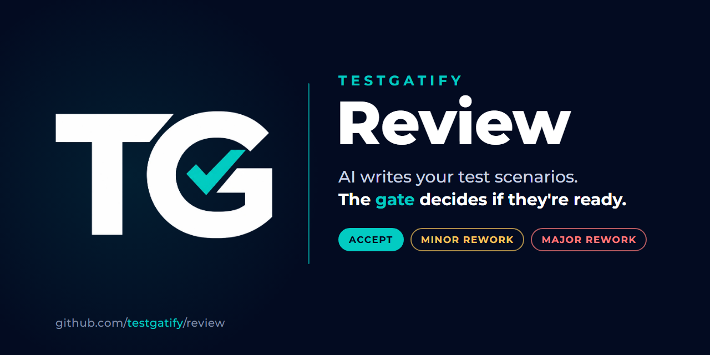

# TestGatify Review

[](https://github.com/testgatify/review/actions/workflows/tests.yml)
[](LICENSE)




**AI writes your test scenarios. The gate decides if they're ready.**

*Part of [TestGatify](https://github.com/testgatify) — Independent AI Testing & Evaluation.*

*Don't just generate tests. Gatify them.*

Writing test scenarios by hand is slow. LLMs can draft them in seconds, but a draft can skip a requirement, cite one that doesn't exist, test only the happy path or repeat itself. TestGatify Review does both jobs a test team needs:

1. **Write.** Claude turns a requirements file into structured test scenarios: steps, expected results, priority, and links back to the requirements.
2. **Gate.** The scenarios go through a **static review**, the same checks a test manager makes in a review meeting, and get a verdict: **ACCEPT**, **MINOR REWORK** or **MAJOR REWORK**.
3. **Export.** The scenarios come out as an **Excel** sheet for people and a **CSV for Jira Xray's Test Case Importer**, ready to load into a test management tool.

```
requirements.yaml ──► Claude writes ──► suite.json ──► the gate (static review) ──► review.md + verdict
                                            │
                                            └──► test_cases.xlsx + xray_import.csv
```

> **Static, not executed.** The gate looks at the test design only (ISTQB: *static testing*). Nothing runs against the application, so the verdict says whether the *scenarios* are ready to use, not whether the *application* works. It is not a runtime evaluation of an AI system; the gate does not measure LLM factual correctness, RAG grounding or agent task success.

## Review checks

| Check | Default threshold | Severity | What it catches |
|---|---|---|---|
| Requirement coverage | ≥ 100% | major | Requirements with no test scenario |
| Traceability | ≥ 100% | major | Scenarios that cite requirement IDs that don't exist (hallucinated links) |
| High-priority negative coverage | ≥ 100% | major | High-priority requirements tested only on the happy path |
| Step completeness | ≥ 95% | major | Steps with no action or no expected result |
| Negative test ratio | ≥ 25% | minor | Suites that are mostly happy-path scenarios |
| Duplicate rate | ≤ 5% | minor | Near-duplicate scenarios (title + steps similarity) |

Thresholds and severities live in [`config/review_checks.yaml`](config/review_checks.yaml).

## Verdicts

Named after the outcomes of a review meeting:

| Verdict | Meaning |
|---|---|
| ✅ **ACCEPT** | Every check is within its threshold. The scenarios can be used as they are. |
| 🛠️ **MINOR REWORK** | Only minor checks failed. Usable after small fixes. |
| ⛔ **MAJOR REWORK** | At least one major check failed. Fix and review again before use. |

`review` and `run` exit with code `1` on MAJOR REWORK, so the gate can stop a CI pipeline.

## Example

[`examples/seeded_suite_with_defects.json`](examples/seeded_suite_with_defects.json) holds 18 scenarios for [SauceDemo](https://www.saucedemo.com), a public practice shop. **They are hand-written, not model output**, and seeded with three known defects to show what the gate catches: a requirement with no scenario, a link to a non-existent requirement, and a duplicated scenario.

```
$ testgatify-review review --requirements requirements/saucedemo.yaml \
      --suite examples/seeded_suite_with_defects.json --report examples/seeded_suite_review.md
At the gate: static review of the test design (nothing is executed).
  [MAJOR] requirement_coverage: 92%
  [MAJOR] traceability: 94%
  [MAJOR] high_priority_negative_coverage: 62%
  [  ok ] step_completeness: 100%
  [  ok ] negative_test_ratio: 39%
  [MINOR] duplicate_rate: 11%
Verdict: MAJOR REWORK  (report: examples/seeded_suite_review.md)
```

All three planted defects were caught, plus three high-priority requirements that had only happy-path scenarios.

| Output | File |
|---|---|
| Review report with a requirement-to-test traceability matrix | [`examples/seeded_suite_review.md`](examples/seeded_suite_review.md) |
| Scenarios as an Excel sheet | [`examples/seeded_suite_test_cases.xlsx`](examples/seeded_suite_test_cases.xlsx) |
| Scenarios as an Xray import CSV | [`examples/seeded_suite_xray_import.csv`](examples/seeded_suite_xray_import.csv) |

## Importing into Jira Xray

The CSV has one row per test step. Rows with the same `TCID` belong to one test; test-level fields are filled on its first row. In Xray's **Test Case Importer**, choose CSV and map the columns:

| CSV column | Xray field |
|---|---|
| `TCID` | Test identifier (groups the steps of one test) |
| `Summary` | Summary |
| `Priority` | Priority |
| `Labels` | Labels |
| `Action` / `Data` / `Expected Result` | Manual test step: Action / Data / Expected Result |
| `Requirements`, `Test Category`, `Precondition` | A custom field, a label, or leave unmapped |

The requirement IDs in this example (`REQ-LOGIN-01`, ...) are not Jira keys. To link tests to requirement issues automatically, use the Jira issue keys as requirement IDs in your YAML file.

## Quick start

Requires Python 3.10+. Writing scenarios needs an [Anthropic API key](https://console.anthropic.com/); the review and export work offline.

```bash
python -m venv .venv
source .venv/bin/activate          # Windows: .venv\Scripts\activate
pip install -e ".[dev]"

export ANTHROPIC_API_KEY=...       # Windows PowerShell: $env:ANTHROPIC_API_KEY="..."

# Write, review and export in one go (results in output/)
testgatify-review run --requirements requirements/saucedemo.yaml

# Or step by step
testgatify-review generate --requirements requirements/saucedemo.yaml --out output/suite.json
testgatify-review review   --requirements requirements/saucedemo.yaml --suite output/suite.json
testgatify-review export   --suite output/suite.json
```

Run the tool's own tests (no API key needed):

```bash
pytest
```

## Design decisions

- **Structured output, not free text.** Claude answers against a strict JSON schema, so every scenario has the same fields and can be checked by code and exported.
- **Deterministic gate.** The checks are plain code, not another LLM call: cheap, reproducible and safe in CI. The model never grades its own work.
- **The prompt and the gate mirror each other.** Every rule given to Claude ("cover every requirement", "only cite existing IDs", "add a negative test for high-priority requirements") has a check that verifies it was followed.
- **Major vs. minor findings.** The same call a test manager makes in a review: some findings send the work back, others are noted.
- **Usable output.** Excel for people, Xray CSV for the test management tool, so accepted scenarios don't have to be retyped.
- **Testable without the API.** The writer is tested with a fake client, so the 24 tests run offline and in CI.
- **Graceful failure.** Refusals, truncated responses and schema mismatches raise clear errors instead of producing a partial suite. Server-side model fallback is enabled for declined requests.

## Project structure

```
requirements/saucedemo.yaml       Input: requirements for the demo app
config/review_checks.yaml         Check thresholds and severities
src/testgatify_review/
  generator.py                    Claude writes the scenarios (JSON schema)
  review_checks.py                The gate: static review and verdict
  report.py                       Markdown review report
  export.py                       Excel and Xray CSV export
  cli.py                          generate / review / export / run
examples/                         Seeded suite, its review and exports
docs/                             Banner (HTML source + PNG) and the TG mark
tests/                            pytest suite (runs offline)
```

## Brand and product boundaries

[TestGatify](https://github.com/testgatify) is the broader **Independent AI Testing & Evaluation** brand. This repository contains **TestGatify Review**, the existing open-source scenario-generation and static-review product.

- **TestGatify Operations** is a separate private management panel; private records and planning documents do not belong in this repository.
- **TestGatify Website** is a planned corporate website and portfolio, not an existing product here.
- **LLM, RAG and Agent Evaluation tools** are future work; Review does not claim runtime AI evaluation results.

Codex and Claude Code share the public instructions in [AGENTS.md](AGENTS.md) and [CLAUDE.md](CLAUDE.md). The GitHub repository is `testgatify/review`, while the Python package/CLI name is `testgatify-review`.

## Roadmap

The following extensions are planned, not current capabilities:

- A real Claude run on the SauceDemo requirements, committed as an example
- LLM-as-judge for qualities code can't measure (clarity, realistic test data), reported next to the static checks
- Turn accepted scenarios into Playwright skeletons and run them against SauceDemo

## About

Built by **[Tülay Güçlü](https://github.com/tulayguclu)**, a QA lead with 14+ years in defence, public-sector and telecom projects, now focused on AI-augmented testing.
[LinkedIn](https://www.linkedin.com/in/tulayguclu/)

## License

[MIT](LICENSE)
